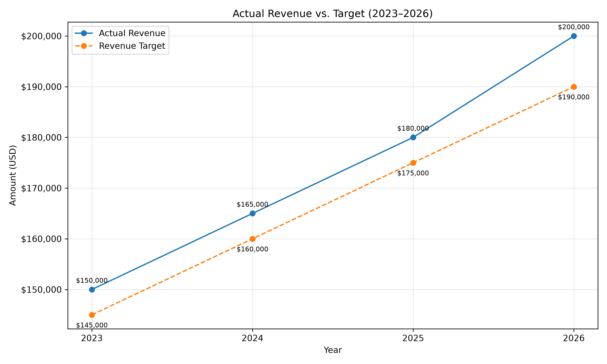
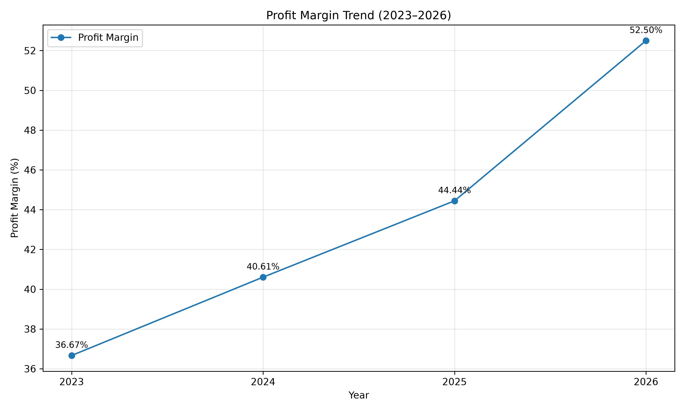
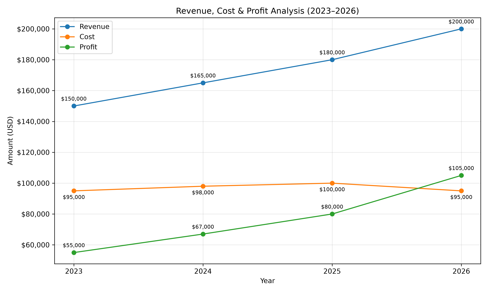

# Financial Performance Analysis

## Project Overview

This project analyzes financial performance from 2023 to 2026 using Python, SQL, Pandas, and Matplotlib.

The objective is to transform financial data into meaningful insights that support financial planning, performance monitoring, and business decision-making.

## Business Objectives

- Analyze revenue, costs, and profit trends.
- Compare actual revenue against targets.
- Monitor profit margins and financial performance.
- Identify cost-saving opportunities.
- Generate executive summaries and actionable financial insights.

## Tools & Technologies

- **Python** — Financial calculations and analysis
- **Pandas** — Data manipulation and KPI calculations
- **SQL (SQLite)** — Financial data storage and querying
- **Matplotlib** — Data visualization
- **VS Code** — Development environment

## Key Performance Indicators (KPIs)

- Revenue
- Cost
- Profit
- Profit Margin
- Revenue vs. Target
- Revenue Variance
- Revenue Growth

## Key Findings

- Revenue reached $200,000 in 2026, exceeding the $190,000 target by $10,000.
- Profit reached $105,000 in 2026.
- Profit margin increased from 44.44% in 2025 to 52.50% in 2026.
- Costs decreased by 5% compared with 2025, while revenue increased by 11.11%.

## Visualizations

### Revenue vs. Target

### Profit Margin Trend

### Revenue, Cost and Profit

## Project Structure

- `hello.py` — Python financial analysis and visualization script
- `financial_analysis_correct.db` — SQLite database containing financial data
- `revenue_vs_target.png` — Revenue and target comparison chart
- `profit_margin_trend.png` — Profit margin trend chart
- `revenue_cost_profit.png` — Revenue, cost, and profit comparison chart

## Conclusion

The analysis indicates improved financial performance in 2026, supported by revenue above target, higher profit margins, and lower costs compared with the previous year.

This project demonstrates practical skills in financial analysis, SQL, Python, KPI monitoring, and data visualization.
